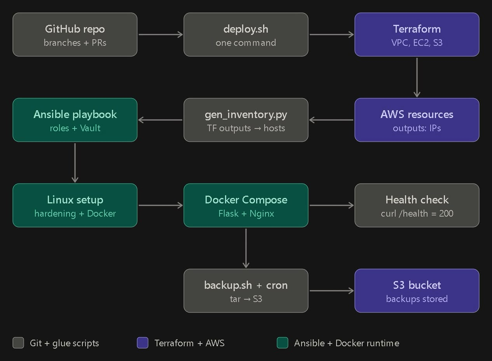

# Automated Deployment of a Containerized App on AWS

One command (`./deploy.sh`) builds the whole stack on AWS, and one command (`./destroy.sh`) removes it.



| Step | Tool | What happens |
|------|------|--------------|
| 1 | **Terraform** | Creates a VPC, a public subnet, an Internet Gateway, security groups, **2 EC2 instances (web + db)** and an **S3 bucket** for backups (plus an IAM role so the DB server can write to that bucket) |
| 2 | **Python** | `scripts/gen_inventory.py` turns `terraform output -json` into an Ansible inventory |
| 3 | **Ansible (roles + Vault)** | Hardens both servers (SSH, ufw, fail2ban) and installs Docker. Secrets come from Ansible Vault |
| 4 | **Docker Compose** | `web`: Flask + Nginx. `db`: PostgreSQL |
| 5 | **Bash** | `scripts/health_check.sh` (`/health` must return 200) and a backup script (`pg_dump` → `.tar.gz` → S3) scheduled with **cron** |
| 6 | **Bash** | `./destroy.sh` deletes everything |

## Repository layout

```
.
├── deploy.sh                  # one command: runs the whole pipeline
├── destroy.sh                 # deletes everything in AWS
├── terraform/                 # VPC, EC2 x2, S3, IAM, security groups
├── scripts/
│   ├── gen_inventory.py       # Terraform outputs -> Ansible inventory
│   ├── health_check.sh        # waits for GET /health == 200
│   ├── check_idempotency.sh   # runs Ansible again and asserts changed=0
│   ├── setup_ubuntu.sh        # installs all prerequisites on Ubuntu
│   └── lib.sh                 # shared helpers
├── ansible/
│   ├── site.yml               # playbook: db -> web
│   ├── group_vars/all/        # vars.yml (+ vault.yml generated, git-ignored)
│   └── roles/                 # common, docker, db, backup, web
├── app/
│   ├── flask/                 # Flask app + Dockerfile
│   └── nginx/                 # Nginx reverse-proxy config
├── tests/                     # unit tests (Python)
└── docs/                      # architecture image + Arabic study guide
```

## Prerequisites

* An AWS account and an IAM user/CLI profile with permissions for EC2, VPC, S3 and IAM.
* Ubuntu 22.04/24.04 (or any Linux/macOS with the same tools).

On Ubuntu everything can be installed with one script:

```bash
./scripts/setup_ubuntu.sh      # git, Terraform, AWS CLI v2, Ansible (in ./.venv)
aws configure                  # Access Key, Secret Key, default region (e.g. eu-central-1)
```

## Quick start

```bash
./deploy.sh                    # ~6-10 minutes the first time
```

At the end it prints the URL of the app, e.g. `http://<web_public_ip>/` and `http://<web_public_ip>/health`.

```bash
./scripts/check_idempotency.sh # second Ansible run: must end with changed=0
./destroy.sh                   # ALWAYS run this when you are done (avoids charges)
```

Useful options: `AWS_REGION=eu-west-1 ./deploy.sh`, `ALLOWED_SSH_CIDR=1.2.3.4/32 ./deploy.sh`,
`ANSIBLE_EXTRA_ARGS="-vv" ./deploy.sh`, `./destroy.sh --yes`, `./destroy.sh --purge`.

## How secrets are handled (nothing sensitive is in the repository)

| Secret | Where it lives |
|--------|----------------|
| AWS credentials | Your AWS CLI profile / environment variables only |
| SSH private key | Generated by `deploy.sh` in `.state/` (git-ignored). Only the *public* key goes to AWS |
| Postgres password | Random value generated on first run, stored **encrypted** in `ansible/group_vars/all/vault.yml` (git-ignored) |
| Vault password | `.vault_pass` (git-ignored, mode 600) |
| S3 access from the DB server | IAM **instance role** – no access keys on the server |
| Terraform state | Local `terraform.tfstate` (git-ignored) |

On the servers the password is written to `.env` files with mode `0600`.
Ansible tasks that handle secrets use `no_log: true`.

## Idempotency

Only Ansible modules with a declarative state are used (`apt`, `copy`, `template`, `ufw`, `cron`, `docker_compose_v2`, …).
The few `command` tasks have `changed_when: false`. Rebuilds/restarts happen through **handlers**, so they only run when a file really changed.
`./scripts/check_idempotency.sh` proves it by parsing the `PLAY RECAP`.

## Design decisions / trade-offs

* **Both servers are in a public subnet** to stay inside the Free Tier (a NAT Gateway costs money). The DB is still protected: its security group accepts port 5432 **only from the web security group**, and Postgres is published only on the private VPC address.
* **SSH is restricted to your current public IP** (auto-detected). If your IP changes, run `./deploy.sh` again to update the security group.
* Docker published ports bypass `ufw`; the AWS **security groups are the real perimeter**, `ufw` is defence in depth.
* `/health` returns **200 only if Flask can reach Postgres** (otherwise 503) – so the health check validates the whole chain web → db.
* Terraform state is local for simplicity. For teams use an S3 backend with DynamoDB locking.

## Tests

```bash
pip install flask psycopg2-binary
python3 -m unittest discover -s tests -v      # inventory generator + Flask app
```

Static checks: `bash -n`, `shellcheck`, `ansible-playbook --syntax-check`, `ansible-lint` (production profile).
For Terraform run: `terraform -chdir=terraform init -backend=false && terraform -chdir=terraform fmt -check && terraform -chdir=terraform validate`.

## Troubleshooting

| Problem | Fix |
|---------|-----|
| `AWS credentials not found` | Run `aws configure` |
| `t3.micro is not eligible for Free Tier` | `export TF_VAR_instance_type=t2.micro` (some regions) |
| SSH timeout in Ansible | Your IP changed → run `./deploy.sh` again, or set `ALLOWED_SSH_CIDR` |
| `apt` lock errors | The playbook waits for cloud-init; just re-run `./deploy.sh` |
| Health check fails | `ssh -i .state/id_ed25519 ubuntu@<web_ip>` then `docker logs flask` / `docker logs nginx` |
| Backup check | `ssh ... ubuntu@<db_ip> 'sudo /usr/local/bin/db-backup.sh && tail /var/log/db-backup.log'` |

## Cost warning

Two `t3.micro` instances + two public IPv4 addresses + a small S3 bucket are (almost) free on the Free Tier,
but **not if they run all month**. Always finish a session with `./destroy.sh`.

## Git workflow used for this project

`main` (stable) ← `feature/terraform`, `feature/ansible`, `feature/app-and-scripts`, each merged through a Pull Request.
